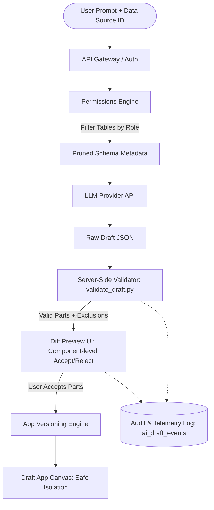

# Functional Specifications (FR1 – FR6)

---

## 1. Functional Requirements Architecture

---

## 2. Requirement Details

### FR1: Input Ingestion & Session Handling
- The endpoint `POST /v1/ai/app-drafts` accepts a prompt string (`min_length: 10`, `max_length: 500`) and a valid `datasource_id`.
- The system resolves the requesting user's identity, workspace context, and associated RBAC role.
- If the prompt is below minimum length or unparseable, returns HTTP `400 Bad Request` with `{"error": "prompt_too_short"}`.

### FR2: Zero-Row Schema Pruning & Prompt Compilation
- To protect user privacy, **no database row values are transmitted to the external model by default**.
- Only schema metadata (table names, column names, data types, and primary/foreign key relationships) is sent.
- Tables for which the user's role lacks read privileges are pruned before prompt construction.

### FR3: Server-Side Validation & Diff Preview
- When the LLM outputs proposed queries and widgets, the system executes server-side validation (`prototype/validate_draft.py`):
  1. **Schema Check:** Every queried table and column must exist in the active schema catalog.
  2. **RBAC Check:** Every referenced table must belong to the user's authorized role set.
  3. **Read-Only Gate:** Any write, drop, or alter statement (`INSERT`, `UPDATE`, `DELETE`, `DROP`, `ALTER`) is rejected.
- Valid parts are formatted into a JSON diff payload (`GET /v1/ai/app-drafts/{draft_id}`) alongside an `excluded` array detailing pruned tables.

### FR4: Selective Atomic Apply to Draft Version
- `POST /v1/ai/app-drafts/{draft_id}/apply` receives `accepted_part_ids`.
- The system creates a new application draft version (`app_version_id`), injects only the accepted queries and components into the canvas DSL, and marks rejected parts as discarded.
- Production apps remain untouched until manual user deployment.

### FR5: Comprehensive Telemetry & Event Logging
- Emits structured telemetry events to `ai_draft_events` at each stage:
  - `draft_created`: Records prompt latency and proposed parts count.
  - `draft_reviewed`: Records accepted vs. proposed count.
  - `draft_applied`: Records successful canvas injection.
  - `app_published`: Records final user publication.

### FR6: Admin Controls & Workspace Governance
- A workspace-level feature flag allows admins to toggle AI generation (`ENABLED` / `DISABLED`).
- An admin security panel allows restricting which connected datasources are eligible for AI indexing.
