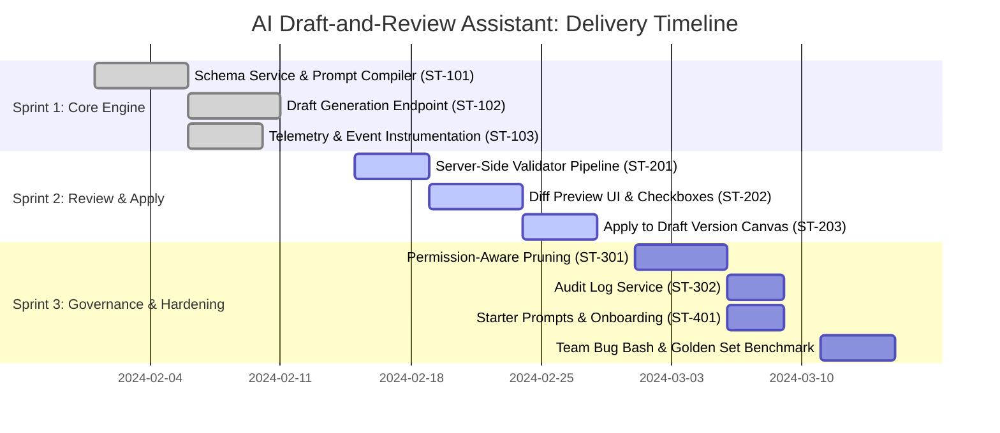

# Sprint Execution Plan (3 Two-Week Sprints)

The MVP delivery is structured into three consecutive 2-week agile sprints, progressing systematically from foundational backend services to user experience and enterprise hardening.

---

## Sprint 1: Scaffolding & Generation Engine
- **Capacity (Assumption):** 16 Story Points | 2 Full-Stack Engineers
- **Objective:** Establish the foundation: prune schemas, compile prompt payloads, call model API, and stream telemetry.
- **Stories Committed:**
  - `ST-101` Schema metadata service & prompt compiler (5 pts)
  - `ST-102` Asynchronous draft generation endpoint (8 pts)
  - `ST-103` Telemetry and event tracking pipeline (3 pts)
- **Sprint 1 Done Definition:** End-to-end curl request returns a structured JSON draft with latency logged to `ai_draft_events`.

---

## Sprint 2: Verification, Diff Preview & Apply
- **Capacity (Assumption):** 18 Story Points | 2 Full-Stack Engineers + 1 Frontend Designer
- **Objective:** Deliver the human-in-the-loop review interface and safe canvas isolation.
- **Stories Committed:**
  - `ST-201` Server-side draft validation engine (`prototype/validate_draft.py`) (5 pts)
  - `ST-202` Diff preview modal with per-part accept/reject checkboxes (8 pts)
  - `ST-203` Apply accepted parts to versioned draft canvas (5 pts)
- **Sprint 2 Done Definition:** Builder can prompt, inspect the diff preview, selectively toggle parts, and see accepted components render on the draft canvas.

---

## Sprint 3: Governance, Onboarding & Alpha Hardening
- **Capacity (Assumption):** 16 Story Points | 2 Full-Stack Engineers + QA Engineer
- **Objective:** Enforce zero-tolerance security gates, add starter prompts, and validate against the 30-prompt golden set.
- **Stories Committed:**
  - `ST-301` Permission-aware filtering with transparent exclusion reasons (8 pts)
  - `ST-302` Immutable audit log service & table schema (3 pts)
  - `ST-401` Context-aware starter prompts on assistant launch (3 pts)
  - `ST-402` Hardened error fallback modal with starter templates (2 pts)
  - Cross-functional team Bug Bash (2 days)
- **Sprint 3 Done Definition:** Golden set benchmark executed with $\ge 90\%$ pass rate, 0 permission leaks, and feature flag ready for staged rollout.
