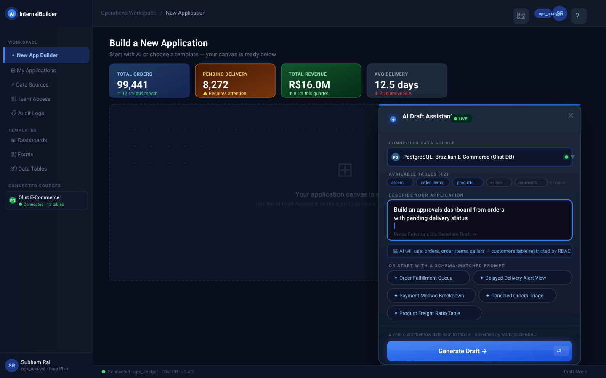
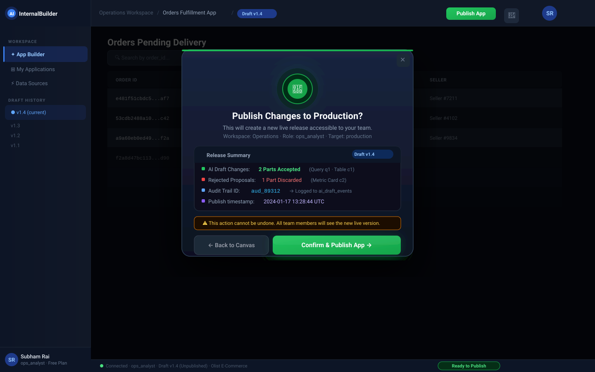
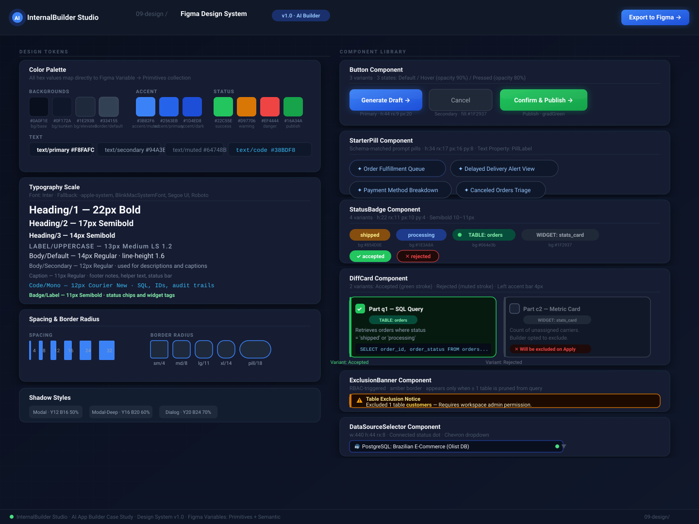

# UI/UX Design System & Screen Specifications

This folder contains **high-fidelity interface designs**, a visual design system, and interaction flow specs for the **AI Draft-and-Review Assistant** — built for a 1440 × 900 px desktop viewport.

---

## Interaction Principles

1. **AI Proposes, Humans Dispose** — AI generations never auto-commit. Every output is staged in a diff preview for component-level human review.
2. **Transparent Boundaries** — RBAC restrictions surface as an explicit amber exclusion banner, never a silent failure.
3. **No Blank-Canvas Paralysis** — Five schema-matched starter prompt pills guide first-time builders.

---

## Screen 1 — Prompt & Starter Prompts

**Key elements:**
- Sidebar nav with connected data source panel (`Olist E-Commerce · 12 tables`)
- Live KPI metric cards: 99,441 orders · 8,272 pending · R$16M revenue · 12.5-day avg delivery
- AI Draft Assistant drawer with data-source selector, active schema pills, and a glowing **Generate Draft** CTA
- Privacy disclosure: *"Zero customer row data sent to model · Governed by workspace RBAC"*

---

## Screen 2 — Granular Diff Preview & Permission Exclusions

**Key elements:**
- **Amber exclusion banner** — `customers` table pruned by RBAC; remaining authorized tables queried
- **Part q1 (✓ Accepted)** — SQL Query card with syntax-highlighted code block, plain-language summary, and green glow border
- **Part c1 (✓ Accepted)** — Table Component card with mini-column-header preview and feature list
- **Part c2 (✕ Rejected)** — Metric Card card, greyed out, with "Excluded on Apply" chip
- Progress bar `2 / 3 selected`, selection summary, and sandboxed-draft notice
- Footer actions: **← Back** · **Cancel** · **Apply 2 Parts →**

---

## Screen 3 — Safe Canvas Isolation & Publish Confirmation

**Key elements:**
- Live rendered data table (Orders Pending Delivery) visible behind a 72% dark overlay
- Publish confirmation dialog with 🚀 icon, release summary, and audit trail:
  - 2 Parts Accepted (Query q1 · Table c1)
  - 1 Part Discarded (Metric Card c2)
  - Audit Trail ID: `aud_89312` → logged to `ai_draft_events`
- Irreversibility warning banner (amber)
- **Back to Canvas** and **Confirm & Publish App →** (green glow CTA)

---

## Design System — Figma Component Reference

**Covers:**
- **Color palette** — all 24 hex tokens (backgrounds, accents, status, text) with Figma Variable names
- **Typography scale** — Heading/1-3 · Label/Uppercase · Body · Caption · Code/Mono · Badge/Label
- **Spacing & border radius** — 6 spacing steps (4–32px) · 5 radius steps (sm → pill)
- **Button component** — Primary (blue gradient) · Secondary (dark) · Publish (green gradient)
- **StarterPill** — 5 schema-matched pill examples
- **StatusBadge** — shipped · processing · TABLE: orders · WIDGET · accepted · rejected
- **DiffCard** — Accepted (green glow) vs Rejected (muted) side-by-side
- **ExclusionBanner** — amber border, left accent, RBAC message
- **DataSourceSelector** — Postgres icon, live connection dot, chevron

---

## Design Token Quick Reference

| Token | Hex | Usage |
|---|---|---|
| `bg/base` | `#0A0F1E` | Page background |
| `bg/elevated` | `#1E293B` | Cards, modals |
| `border/default` | `#334155` | Dividers, outlines |
| `accent/primary` | `#2563EB` | Primary CTA gradient start |
| `accent/dark` | `#1D4ED8` | Primary CTA gradient end |
| `status/success` | `#22C55E` | Accepted checkboxes, borders |
| `status/warning` | `#D97706` | Exclusion banner border |
| `status/danger` | `#EF4444` | Rejected labels |
| `status/publish` | `#16A34A` | Publish CTA |
| `text/primary` | `#F8FAFC` | Headings |
| `text/secondary` | `#94A3B8` | Descriptions |
| `text/code` | `#38BDF8` | SQL, audit trail IDs |

**Font:** Inter · Fallback: `-apple-system, BlinkMacSystemFont, Segoe UI, Roboto`

**Artboard:** 1440 × 900 px desktop (Screens 1–3) · 1440 × 960 px (Screen 2) · 1440 × 1080 px (Design System)
